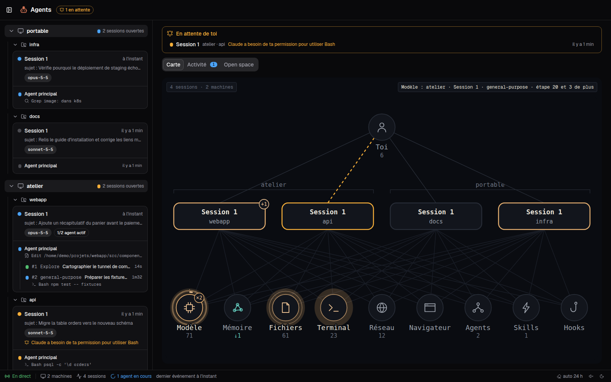
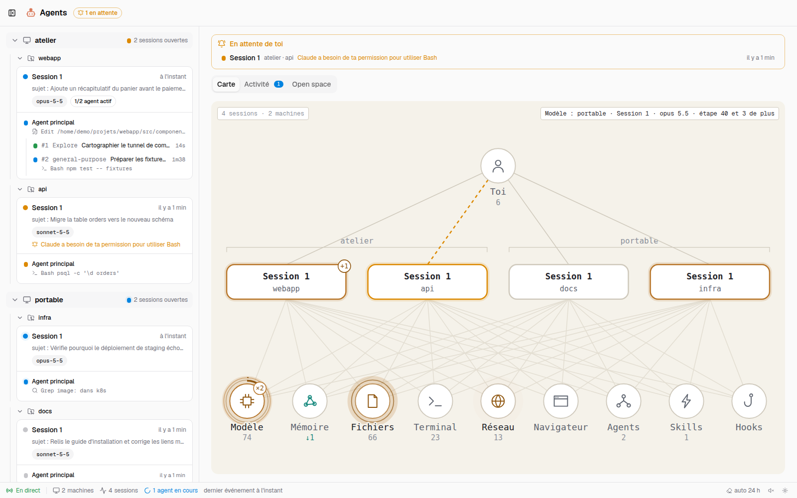
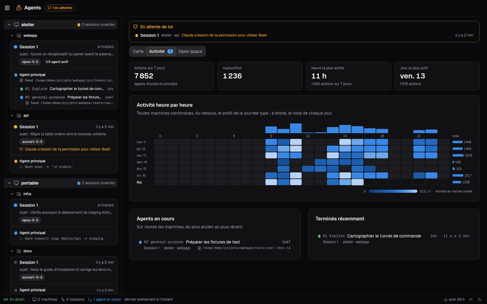
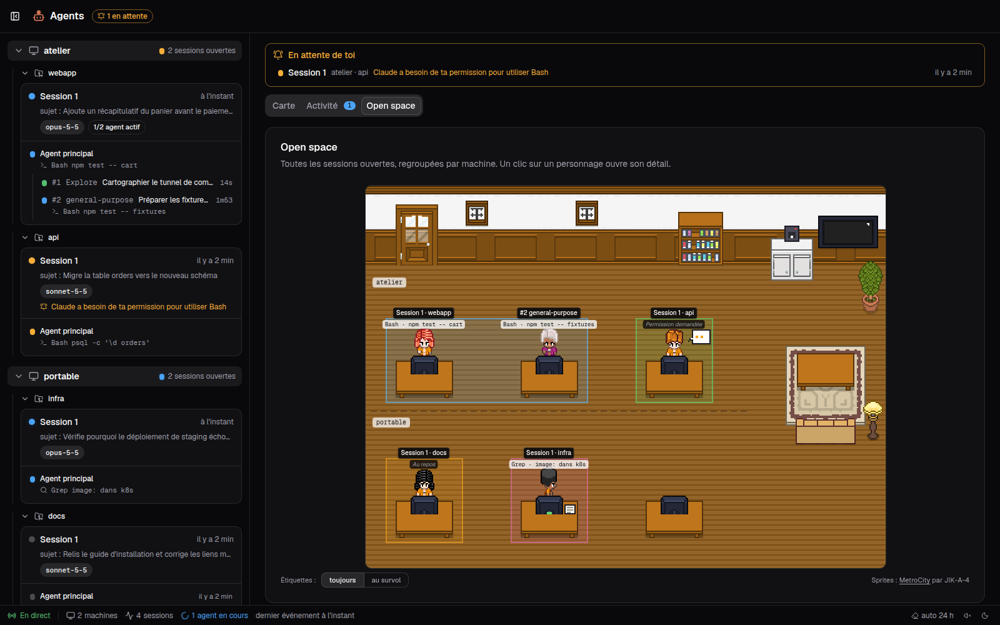
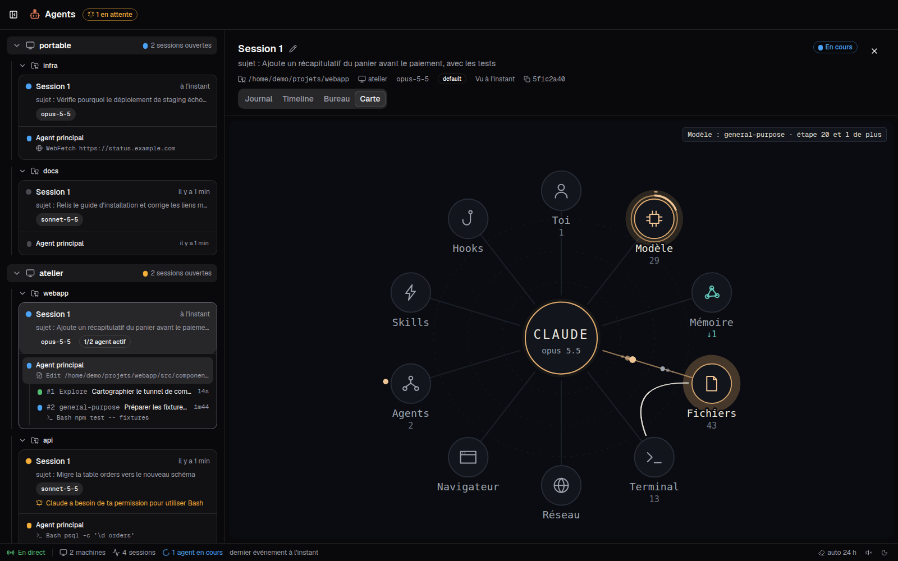
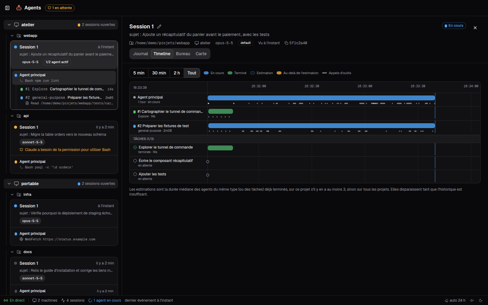
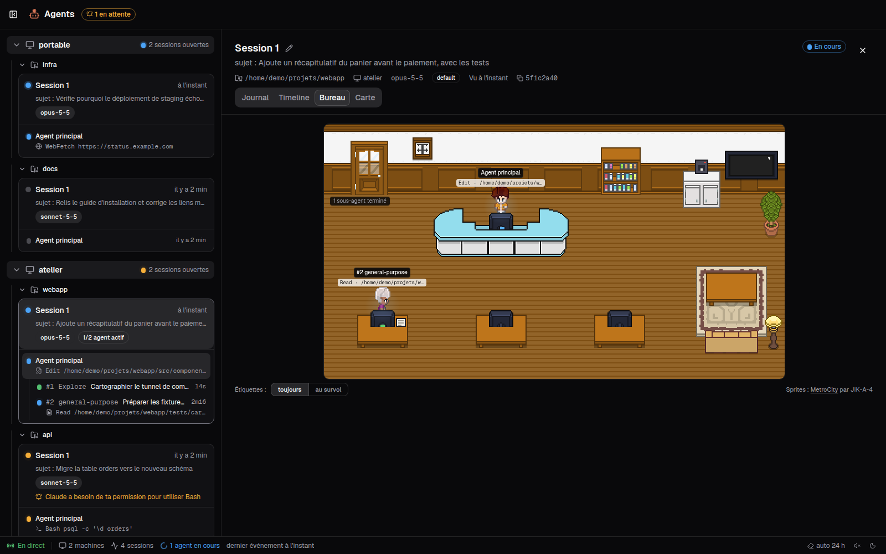
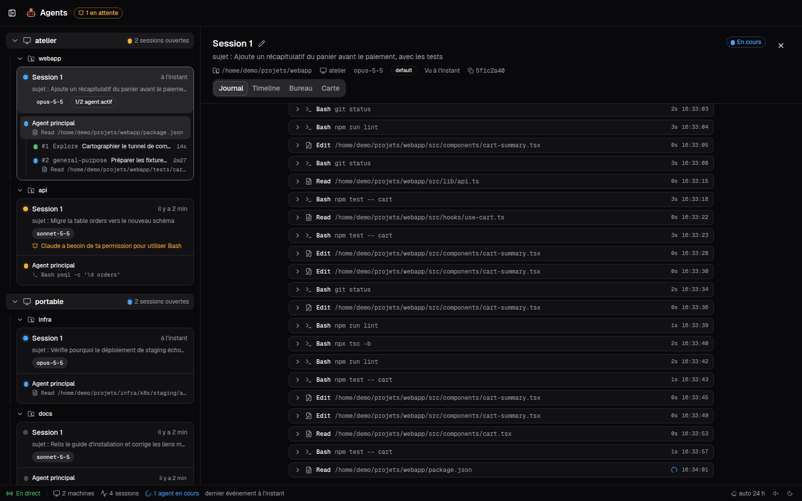
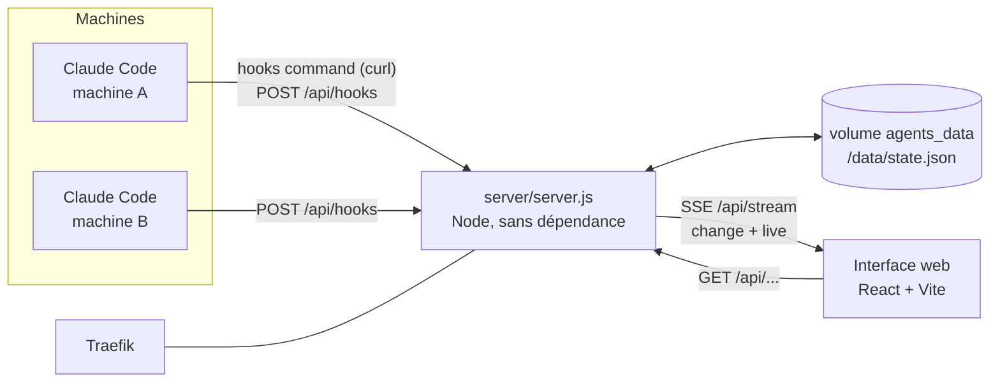

# Agents

![Claude Code hooks][badge-claude] ![Node.js 22][badge-node] ![React 19][badge-react] ![Vite 8][badge-vite] ![Tailwind CSS 4][badge-tailwind] ![TypeScript 6][badge-ts] ![shadcn/ui][badge-shadcn] ![Docker Compose][badge-docker] ![Traefik][badge-traefik] ![Serveur sans dépendance][badge-deps]

Tableau de bord web, en temps réel, des sessions [Claude Code][claude-code] et de leurs sous-agents, sur toutes les machines du réseau local. Chaque session envoie ses [hooks][hooks] à l'application, auto-hébergée derrière [Traefik][traefik], qui affiche ce que font les agents : prompts, appels d'outils, sous-agents, tâches, demandes de permission.



## Sommaire

- [Aperçu](#aperçu)
- [Démarrage rapide](#démarrage-rapide)
- [Brancher une machine](#brancher-une-machine)
- [Ce qui est affiché](#ce-qui-est-affiché)
  - [Accueil](#accueil)
  - [Détail d'une session](#détail-dune-session)
  - [Barre latérale, statut et nettoyage](#barre-latérale-statut-et-nettoyage)
- [Architecture](#architecture)
- [Développement](#développement)
- [Limites connues](#limites-connues)
- [Crédits](#crédits)

## Aperçu

| | |
|---|---|
|  |  |
| **Accueil · Carte** : l'arbre de toutes les sessions ouvertes (thème clair) | **Accueil · Activité** : chiffres clés, heatmap 7 jours, agents en cours |
|  |  |
| **Accueil · Open space** : toutes les sessions en pixel art | **Session · Carte** : stations et impulsions par appel, en temps réel |
|  |  |
| **Session · Timeline** : Gantt des tours, agents et tâches | **Session · Bureau** : un personnage par agent, en pixel art |
|  | |
| **Session · Journal** : chronologie des prompts et des outils | |

> Les captures viennent d'une instance de démonstration alimentée par des sessions fictives.

## Démarrage rapide

```bash
cp .env.example .env          # IP, DOMAIN, HOOK_TOKEN (optionnel), RETENTION_DAYS
docker compose up -d --build
```

L'application est servie sur `http://agents.${IP}.${DOMAIN}` (HTTP seulement, la stack n'a pas de HTTPS). La stack `traefik` doit tourner avant : elle crée le réseau `traefik` utilisé ici.

| Variable | Défaut | Rôle |
|----------|--------|------|
| `HOOK_TOKEN` | vide | Si défini, `POST /api/hooks` exige l'en-tête `X-Hook-Token` |
| `RETENTION_DAYS` | `7` | Les sessions sans activité depuis ce nombre de jours sont supprimées |

L'image est construite localement : Watchtower ne la met pas à jour. Pour reprendre aussi l'image de base Node :

```bash
docker compose build --pull && docker compose up -d
```

## Brancher une machine

Une machine envoie ses sessions dès que ses hooks Claude Code pointent vers l'application. L'application sert elle-même les scripts d'installation : pas besoin d'accès au dépôt.

### 1. Prérequis

- Être sur le réseau local, avec un DNS qui résout `agents.10.0.0.10.sslip.io` vers `10.0.0.10`. Certains DNS bloquent les noms publics qui pointent vers une adresse privée (protection anti-rebinding[^rebinding] de Pi-hole ou de certaines box) : tester avec `nslookup agents.10.0.0.10.sslip.io`.
- Linux et macOS : `curl` et `python3` (pour modifier `settings.json` sans l'écraser).
- Windows : Windows PowerShell 5.1 ou PowerShell 7. [Git for Windows][git-for-windows] est recommandé (voir plus bas).

### 2. Installer les hooks

Linux, macOS :

```bash
curl -fsSL http://agents.10.0.0.10.sslip.io/install-hooks.sh | sh -s -- --host <nom>
```

Windows (PowerShell) :

```powershell
& ([scriptblock]::Create((irm http://agents.10.0.0.10.sslip.io/install-hooks.ps1))) -HostName <nom>
```

`<nom>` est le nom de la machine affiché dans le tableau (lettres, chiffres, `.`, `_`, `-`) ; par défaut, le nom d'hôte. Le script :

- ajoute les hooks dans `~/.claude/settings.json` (ou `$CLAUDE_CONFIG_DIR/settings.json`), au niveau utilisateur pour couvrir tous les dossiers ;
- garde les hooks déjà présents, ne crée pas de doublon s'il est relancé, et laisse une copie de l'ancien fichier dans `settings.json.bak-agents` ;
- teste la connexion à l'application et affiche le résultat.

| Option (sh / PowerShell) | Effet |
|--------------------------|-------|
| `--host` / `-HostName` | Nom de la machine dans le tableau |
| `--url` / `-Url` | Autre adresse de l'application |
| `--token` / `-Token` | Valeur de `HOOK_TOKEN`, s'il est défini dans le `.env` de la stack |
| `--uninstall` / `-Uninstall` | Retire les hooks |

### 3. Relancer les sessions

Une session déjà ouverte n'est pas garantie de prendre en compte les nouveaux hooks : la relancer. Elle apparaît sur le tableau à son premier événement, sans l'historique antérieur.

Quand une version de l'application écoute de nouveaux événements, relancer le script d'installation sur chaque machine : il remplace les hooks existants sans créer de doublon.

<details>
<summary><strong>Fonctionnement des hooks</strong></summary>

- Ce sont des hooks `command` qui envoient le JSON reçu sur l'entrée standard à `POST /api/hooks`, pour 19 événements : `SessionStart`, `SessionEnd`, `UserPromptSubmit`, `PreToolUse`, `PostToolUse`, `PostToolUseFailure`, `SubagentStart`, `SubagentStop`, `Stop`, `StopFailure`, `Notification`, `TaskCreated`, `TaskCompleted`, `PermissionRequest`, `PermissionDenied`, `PreCompact`, `PostCompact`, `PostModelSwitch`, `InstructionsLoaded`. `PostModelSwitch` demande Claude Code 2.1.251 ou plus récent.
- La réponse de l'application est jetée (`curl -o /dev/null`, `Out-Null` en PowerShell) : pour `PreCompact`, `PostModelSwitch` et `PermissionRequest`, Claude Code lit la sortie standard du hook (consignes de résumé, contexte ajouté, décision de permission), et un message d'erreur de l'application s'y retrouverait.
- Ce ne sont pas des hooks `"type": "http"` : Claude Code refuse un hook HTTP vers une adresse privée (`10.0.0.10`) et n'autorise que le loopback.
- Ils sont synchrones pour que les événements arrivent dans l'ordre : chaque appel d'outil attend la réponse de l'application. Si l'application ne répond pas, l'envoi abandonne au bout de 2 secondes et Claude Code continue : un hook en échec ne bloque pas l'agent.
- Sous Windows, Claude Code exécute les hooks [avec Git Bash s'il est installé, sinon avec PowerShell][hooks]. Le script détecte Git Bash : avec lui, le hook est une commande `curl.exe` ; sans lui, une commande `Invoke-RestMethod`, plus lente car PowerShell met plusieurs centaines de millisecondes à démarrer, deux fois par appel d'outil. La commande PowerShell a été testée avec PowerShell 7 sous Linux, pas sous Windows.

</details>

<details>
<summary><strong>Dépannage</strong></summary>

| Symptôme | Cause probable |
|----------|----------------|
| Le test de connexion échoue (code `000`, `0` sous PowerShell) | Machine hors du réseau local, ou DNS qui ne résout pas `*.sslip.io` vers une adresse privée |
| Le test répond « token refusé » | `--token` différent de `HOOK_TOKEN` dans le `.env` de la stack |
| Le test passe, mais aucune session n'apparaît | Session ouverte avant l'installation (la relancer), `"disableAllHooks": true` dans un fichier de réglages, ou `allowManagedHooksOnly` imposé par une configuration d'organisation |
| `python3` introuvable (macOS) | Installer les Command Line Tools : `xcode-select --install` |

</details>

## Ce qui est affiché

### Accueil

La page d'accueil (titre « Agents » de la barre du haut) donne une vue d'ensemble de toutes les machines. En haut, un bandeau liste les sessions qui attendent une réponse ou une permission (un clic ouvre la session). Dessous, trois onglets, dont le choix est retenu par navigateur.

#### Carte : l'arbre des sessions

Un arbre en trois étages, en temps réel, pour toutes les sessions ouvertes de toutes les machines :

| Étage | Contenu |
|-------|---------|
| Haut | **Toi**, relié à chaque session : prompts, demandes d'autorisation et réponses passent par ce lien, qui devient un pointillé ambre qui défile quand la session t'attend |
| Milieu | **Les sessions**, en rectangles arrondis qui portent le titre de la session et le nom du projet, regroupées par machine (nom au-dessus du groupe), de la plus ancienne à la plus récente. Contour orange qui respire quand elle travaille, ambre quand elle t'attend, gris au repos ; badge `+N` pour ses sous-agents en cours |
| Bas | **Les stations partagées** (Modèle, Mémoire, Fichiers, Terminal, Réseau, Navigateur, Agents, Skills, Hooks), reliées à chaque session |

- Un appel envoie un point de la session vers la station, puis un autre au retour (gris, ou rouge en cas d'échec).
- Les stations, Toi compris, s'affichent comme sur la carte d'une session : compte des appels récents (les 60 derniers événements de chaque fil), aiguilles pendant un appel, `×N` pour les appels simultanés, pastille rouge pour les erreurs et refus.
- En haut à gauche, le nombre de sessions et de machines ; en haut à droite, ce qui tourne en ce moment.
- Survol d'une station : sa fenêtre, chaque ligne préfixée par la machine et la session d'origine ; un clic l'épingle. Survol d'une session : son fil ; un clic l'ouvre.

#### Activité

Quatre chiffres clés (actions sur 7 jours, aujourd'hui, heure et jour les plus actifs), puis la heatmap des 7 derniers jours heure par heure (appels d'outils et prompts, toutes machines confondues), puis les agents en cours (avec leur dernier outil) et les derniers terminés ; chaque ligne ouvre l'agent concerné. L'onglet affiche le nombre d'agents en cours.

- La heatmap se recharge toutes les minutes.
- Elle utilise une seule teinte (bleu, avec ses propres paliers en thème sombre) sur une échelle en racine carrée, pour que les petites heures restent visibles à côté des pics.
- Au-dessus, le profil de la journée type (somme des 7 jours par heure) ; à droite, le total de chaque jour.
- Le survol d'une case met en évidence sa ligne et sa colonne et affiche le détail ; l'heure en cours est entourée, les heures à venir sont en pointillés.

#### Open space

Une seule pièce en pixel art pour toutes les sessions ouvertes, avec la porte et le coin salon du [Bureau](#bureau).

- Une zone par machine, empilées par ordre alphabétique, avec le nom de la machine au sol. Une zone compte des rangées de trois tables ; la pièce s'allonge quand les sessions et sous-agents augmentent.
- Chaque session a son îlot, délimité par un fond de couleur : l'agent principal, puis ses sous-agents en cours aux tables voisines. Quand un îlot grandit ou rétrécit, les personnes déplacées rejoignent leur nouvelle table à pied.
- Les agents principaux gardent la veste orange ; peau et coiffure dépendent de la session. Leur étiquette indique la session et le projet (« Session 11 · agents »).
- Comportement identique au Bureau : entrée et sortie par la porte, pauses de l'agent principal dans le coin salon (une activité n'accueille qu'une personne à la fois), bulles (celle de permission reste sur l'agent principal), réduction des animations. Un clic sur un agent principal ouvre sa session, un clic sur un sous-agent ouvre son détail.

### Détail d'une session

Le détail d'une session ou d'un agent a quatre vues : **Journal**, **Timeline**, **Bureau** et **Carte** (choix retenu par navigateur). Le bouton ✕ ou la touche Échap ferment le détail. Dans l'en-tête, l'identifiant de la session se copie d'un clic sous la forme `claude --resume <id>`, pour la reprendre dans un terminal.

- **Par session** : dossier de projet, machine, modèle, mode de permission, état, prompts, appels d'outils (entrée et sortie, tronquées à 4 000 caractères), réponse finale de chaque tour.
- **Par agent** : type, description, consigne complète, arborescence parent / sous-agents, dernier outil utilisé, chronologie de ses outils, rapport final, tokens et durée (agents au premier plan uniquement).

| État d'une session | Signification |
|--------------------|---------------|
| En cours | Un tour est en cours |
| Au repos | Le dernier tour est terminé |
| En attente de toi | `Notification` de Claude Code, comme une demande de permission (sauf `idle_prompt`, envoyée 60 s après tout tour terminé, seulement notée dans le journal) |
| Fermée | `SessionEnd` reçu |
| Sans nouvelles | « En cours » sans événement depuis 10 minutes (plantage, terminal tué) |
| Erreur | `StopFailure` reçu (erreur d'API), jusqu'au prochain prompt ou outil |

Les hooks ne transmettent pas les messages intermédiaires du modèle, seulement le dernier message de chaque tour (`Stop`, `SubagentStop`).

#### Noms affichés

- **Session** : « Session N », numérotée à son arrivée par machine et par projet, sans jamais réutiliser un numéro, ou le nom donné à la main (crayon à côté du titre). Le sujet en cours (titre que donne Claude Code, sinon dernier prompt) s'affiche en dessous.
- **Agent principal** : le fil principal et son dernier outil, puis ses sous-agents dans l'arbre de la session.
- **Sous-agent** : « #N » (numéro d'ordre dans la session), son type et le nom de sa tâche (la description passée à l'outil `Agent`). Un agent lancé avant l'installation des hooks n'a pas de tâche connue : « Tâche inconnue · <début de son identifiant> ».

#### Timeline

Vue de type Gantt, rafraîchie chaque seconde, sur 5 minutes, 30 minutes, 2 heures ou toute l'activité (par défaut) :

- une ligne pour la session principale, avec une barre par tour de conversation (du prompt à la fin de la réponse) ;
- une ligne par agent, dans l'ordre de l'arborescence, de son lancement à sa fin ;
- une ligne par tâche de la liste de tâches de Claude (outils `TaskCreate` / `TaskUpdate` et événements `TaskCreated` / `TaskCompleted`, ou l'ancien outil `TodoWrite`) : un cercle tant qu'elle attend, une barre une fois commencée ;
- sous chaque barre, les appels d'outils (rouges en cas d'échec).

Pour un agent ou une tâche en cours, la fin estimée apparaît en pointillés, et le dépassement en orange. L'estimation est la durée médiane des agents du même type (ou des tâches) déjà terminés : sur le même projet s'il y en a au moins 3, sinon sur tous les projets, sinon aucune estimation. Elle est calculée par l'application, sans rien demander à Claude Code.

#### Bureau

Une vue en pixel art de la session : l'agent principal derrière le comptoir d'accueil (veste orange), chaque sous-agent en cours à sa propre table, et un coin salon à droite (machine à café, TV, table basse, canapé, lampadaire, plante, bibliothèque).

- **Arrivées et départs** : un sous-agent reçoit une table à son démarrage (au plus près de son parent s'il en a un), entre par la porte et marche jusqu'à elle. À sa fin, il affiche une coche, se lève et ressort ; sa table est libérée. Une rangée de trois tables s'ajoute quand toutes sont prises. Sous la porte, « N sous-agents terminés » rappelle ceux déjà repartis.
- **Apparence** : un type d'agent a toujours la même apparence (`Explore`, `general-purpose` et `Plan` ont un look fixe, les autres types en reçoivent un parmi les cinq restants, sans doublon dans une même session tant qu'il en reste). La veste orange est réservée à l'agent principal.
- **Animation** : lecture (`Read`, `Grep`, `Glob`, `WebFetch`, `WebSearch`, `ToolSearch`, `NotebookRead`, `LS`) avec une feuille sur le bureau et un voyant vert ; frappe pour les autres outils (voyant bleu clignotant) ; immobile au repos. Un agent qui travaille est éclairé par la lueur de son écran.
- **Pauses** : au repos depuis 30 secondes, l'agent principal part en pause (café, canapé devant la TV, bibliothèque ou plante, 15 à 40 secondes par activité). Dès qu'il reprend le travail ou qu'une permission est demandée, il retourne à son bureau. Une session sans nouvelles fait la sieste sur le canapé. Les sous-agents restent à leur table.
- **Bulles** : « … » ambre pour une permission demandée (sur le sous-agent concerné si le hook `Notification` indique son `agent_id`), coche verte en fin de tour, « ! » rouge pour une interruption ou une erreur, « z » pour une session sans nouvelles.
- **Étiquettes** : au-dessus de chaque personnage, son nom et l'outil en cours ou ce qu'il fait (« Pause café… », « Permission demandée »). Le choix « Étiquettes : toujours / au survol » (retenu par navigateur, commun avec l'open space) les affiche en permanence ou au survol.
- **Interaction** : le survol affiche la tâche, l'état, l'outil et la durée, avec un contour blanc d'un pixel ; un clic ouvre le détail de l'agent.
- À la fermeture de la session, tout le monde sort et le bureau s'assombrit. Avec la réduction des animations activée sur le système, chacun reste à son bureau.

#### Carte

Une carte du travail adaptée de [lot-map][lot-map] : au centre, la session (« CLAUDE ») ou l'agent ouvert (« #N ») avec son modèle ; autour, dix stations. Chaque appel envoie une impulsion du centre vers sa station, puis une autre au retour ; les appels des sous-agents partent de la station Agents.

<details>
<summary><strong>Ce qui allume chaque station</strong></summary>

| Station | Ce qui l'allume |
|---------|-----------------|
| Toi | prompts, demandes de permission (`PermissionRequest`), réponse finale, `AskUserQuestion`, `SendUserFile` |
| Modèle | chaque étape du modèle (« opus 5.5 · étape 3 », déduite des appels d'outils), compactage du contexte (`PreCompact` / `PostCompact`), changement de modèle (`PostModelSwitch`), erreurs `StopFailure` |
| Mémoire | lecture ou écriture dans le dossier mémoire de Claude Code, `.claude/rules/` ou un `CLAUDE.md`, serveur MCP `memory` ; fichiers d'instructions chargés sans demande (`InstructionsLoaded`, impulsion creuse, compteur `↓`) |
| Fichiers | `Read`, `Write`, `Edit`, `Grep`, `Glob`, et les commandes shell qui ne font que lire ou manipuler des fichiers (`cat`, `grep`, `sed`, `mv`…) |
| Terminal | les autres commandes shell, le serveur MCP `terminal` et les outils non classés ailleurs (`TaskCreate`, `TodoWrite`…) |
| Réseau | `WebFetch`, `WebSearch`, `Artifact`, serveurs MCP, commandes réseau (`curl`, `gh`, `ssh`, `git push`, `npm install`, `docker pull`…) |
| Navigateur | outils de navigateur (Claude in Chrome, navigateur intégré) |
| Agents | lancement de sous-agents et de workflows, `SendMessage`, `TaskStop` ; un point tourne autour de la station par sous-agent en cours |
| Skills | `Skill`, `ToolSearch` |
| Hooks | appel refusé (`PermissionDenied` du mode auto), ou resté sans réponse à la fin du fil (refusé par un hook ou une permission, ou interrompu) |

</details>

- **Lecture de la carte** (comme dans lot-map) : une ligne relie les dernières stations visitées, deux aiguilles tournent autour d'une station pendant un appel long (une minute, dix minutes), `×N` compte les appels simultanés, une pastille rouge compte les erreurs et refus depuis le dernier prompt, un anneau quitte le centre quand la réponse est prête.
- **Fenêtres au survol** : le centre affiche la session, son modèle, l'action en cours et les dernières lignes d'activité (`●` en cours, `·` terminé, `✕` échec ou refus, `◆` changement de modèle) ; une station affiche son nombre d'appels, ses appels en cours, ses trois cibles les plus servies et ses échecs. Un clic l'épingle en haut à droite.
- **Temps réel** : la carte s'abonne à `GET /api/stream?live=<id>` et superpose les derniers événements reçus à chaque hook au détail complet de la session ; l'historique et les compteurs restent entiers. La carte montre uniquement le temps réel.

Étapes du modèle : les hooks ne signalent pas les requêtes au modèle, elles sont donc déduites. Le modèle travaille entre la fin d'un lot d'appels d'outils (ou le prompt, ou le lancement d'un sous-agent) et le lot suivant (ou la fin du tour) ; des appels lancés à moins de 300 ms d'intervalle, ou avant la fin des précédents, forment un seul lot. La durée affichée inclut donc la latence des hooks.

Différences avec lot-map : les hooks ne transmettent pas le remplissage du contexte, donc l'anneau de contexte autour du centre n'existe pas. Les impulsions partent à la réception de l'événement par le navigateur (pas à l'heure du serveur), pour rester visibles malgré un décalage d'horloge.

### Barre latérale, statut et nettoyage

La liste des sessions est organisée par machine (nom envoyé par le hook), puis par dossier de projet. Machines et dossiers se replient d'un clic ; repliés, ils gardent leur nombre de sessions ouvertes et leur état le plus urgent. Un agent qui travaille dans un worktree (`<dépôt>/.claude/worktrees/<nom>`) est rattaché au dépôt.

Repliée (écran large seulement), la barre latérale devient une colonne de raccourcis, un par session : initiales du projet, point d'état, nombre d'agents en cours ; le survol affiche la session, sa machine, son état et son sujet.

La barre du haut garde le bouton qui replie la barre latérale, le titre (retour à l'accueil) et un badge « N en attente » quand des sessions t'attendent.

| Barre de statut | Contenu |
|-----------------|---------|
| À gauche | État du flux temps réel (« En direct », ou « Hors ligne » sur fond rouge), machines actives, sessions ouvertes, agents en cours, ancienneté du dernier événement reçu (grand écran) |
| À droite | Interrupteur « Fermées (N) », menu « Nettoyage » (« manuel » ou « auto 1 h / 24 h / 7 j »), bouton « Sons », thème (clair, sombre ou automatique) |

- **Préférences retenues par navigateur** : thème, sons, barre latérale repliée, machines et dossiers repliés, interrupteur « Fermées », onglet de l'accueil, vue du détail, plage de la Timeline, mode des étiquettes.
- **Sons** (désactivés par défaut) : un court carillon, généré par le navigateur, quand une session termine son tour, et un autre quand une session demande une permission. Après un rechargement, le navigateur n'autorise le son qu'après un premier clic ou une touche.
- **Sessions fermées** : une session est fermée quand elle a envoyé `SessionEnd`, ou quand elle est « en cours » sans événement depuis 10 minutes. Masquée par défaut, elle s'affiche avec une carte en pointillés, un titre barré, depuis quand elle est fermée et, si le nettoyage automatique est actif, le temps avant son retrait.
- **Nettoyage** : « Retirer les sessions fermées » (après confirmation), ou le nettoyage automatique (24 h par défaut, ou 1 h, 7 jours, désactivé) qui retire chaque minute toute session sans événement depuis ce délai. Une session retirée revient au prochain événement qu'elle envoie. Le nettoyage n'efface pas l'historique des durées qui sert aux estimations.

## Architecture



- `web/` : interface React avec [Vite][vite], [Tailwind CSS][tailwind] v4 et [shadcn/ui][shadcn], compilée dans l'image Docker.
- `server/server.js` : serveur Node sans dépendance. Il reçoit les hooks, tient l'état en mémoire, sert l'interface et pousse les changements en [SSE][sse].
- **Temps réel** : chaque hook déclenche un signal `change` sur le flux. Les navigateurs abonnés avec `?live=all` (arbre de l'accueil) ou `?live=<id>` (carte d'une session) reçoivent en plus la session modifiée, allégée, sans avoir à la recharger.

<details>
<summary><strong>API</strong></summary>

| Méthode et chemin | Rôle |
|-------------------|------|
| `GET /api/health` | Santé du serveur (healthcheck Docker) |
| `POST /api/hooks` | Reçoit le JSON d'un hook Claude Code tel quel (en-têtes optionnels `X-Agent-Host`, `X-Hook-Token`) |
| `GET /api/sessions` | Résumé de toutes les sessions (sans les chronologies) |
| `GET /api/sessions/:id` | Session complète : chronologie de chaque agent, tours de conversation, tâches, estimations de durée |
| `PATCH /api/sessions/:id` | `{ "name": "..." }` renomme une session (80 caractères au maximum ; vide pour revenir au nom automatique) |
| `DELETE /api/sessions` | Retire les sessions fermées et celles sans nouvelles depuis 10 minutes |
| `GET /api/settings`, `PUT /api/settings` | `{ "autoCleanupMs": 86400000 }` : délai du nettoyage automatique (`0`, 1 h, 24 h ou 7 jours) |
| `GET /api/galaxy` | Sessions ouvertes, allégées pour l'arbre de l'accueil : 60 derniers événements et 60 derniers tours par fil, sans les sorties d'outils, entrées tronquées à 400 caractères et textes à 120, sous-agents en cours ou terminés depuis moins de 10 minutes, sans tâches ni estimations |
| `GET /api/activity` | Compteurs d'appels d'outils et de prompts par heure, sur 8 jours (heatmap) |
| `GET /api/stream` | Flux SSE qui signale chaque changement. `?live=all` pousse aussi, à chaque hook, la session modifiée sous la forme allégée de `/api/galaxy` ; `?live=<id>`, seulement cette session |

</details>

<details>
<summary><strong>Stockage et rétention</strong></summary>

Volume nommé `agents_data` (`/data/state.json`), écrit au plus une fois par seconde : sessions, réglages et historique des durées.

| Donnée | Rétention |
|--------|-----------|
| Sessions | `RETENTION_DAYS` jours sans activité (7 par défaut), 300 sessions, 500 événements par fil, 200 tours et 200 tâches par session au maximum |
| Historique des durées (agents et tâches terminés) | 30 jours, 5 000 entrées au maximum |
| Activité par heure (heatmap) | 8 jours, indépendamment des sessions retirées |

</details>

<details>
<summary><strong>Organisation du code</strong></summary>

| Dossier ou fichier | Contenu |
|--------------------|---------|
| `server/server.js` | Réception des hooks, état, API, flux SSE |
| `web/src/components/lotmap/` | Carte d'une session et arbre de l'accueil : classement des appels et dessin SVG (`map.ts`, porté de lot-map), fenêtres (`card.tsx`), arbre (`global.tsx`), horaires locaux des impulsions (`hooks.ts`), carte de session (`index.tsx`) |
| `web/src/components/office/` | Bureau : plan et trajets sur une grille de 16 px (`layout.ts`), comportement des personnages (`engine.ts`), dessin trié par profondeur (`draw.ts`), sprites (`assets.ts`), étiquettes (`labels.tsx`) |
| `web/src/components/openspace/` | Open space : plan des zones et îlots (`layout.ts`), dessin (`draw.ts`) ; réutilise le moteur et les sprites du Bureau |
| `web/public/` | Scripts d'installation des hooks (`install-hooks.sh`, `install-hooks.ps1`) et sprites du Bureau (`office/`) |
| `scripts/office-assets.py` | Extraction des sprites MetroCity vers `web/public/office/` |

</details>

## Développement

```bash
cd web
npm install
npm run dev   # proxy /api vers http://localhost:3000
```

Pour le serveur en local, depuis ce dossier : `PORT=3000 DATA_DIR=./data node server/server.js`. Il sert le dossier `public/`, qui contient le front compilé dans l'image (`web/dist`).

Les sprites du Bureau sont extraits par `python3 scripts/office-assets.py <dossier MetroCity>` (Pillow requis) : calques des personnages, comptoir, écran, table, sol, mur, décor et coin salon (la machine à café est dessinée en code).

## Limites connues

- ⚠️ Pas d'authentification sur l'interface : les prompts, les commandes et le contenu des fichiers lus par les agents sont lisibles par tout appareil du réseau local. Sans `HOOK_TOKEN`, n'importe quel appareil du réseau peut aussi envoyer de faux événements.
- Les agents lancés par un workflow n'ont pas d'appel Agent : leur consigne et leur description sont inconnues.
- L'association d'un sous-agent à l'appel qui l'a lancé est provisoire jusqu'au `PostToolUse` de cet appel (le plus ancien appel en attente du même type est retenu au démarrage, à défaut le plus ancien tous types confondus).
- Claude Code lance des agents internes (par exemple les résumés périodiques de la progression d'un agent en arrière-plan) qui n'envoient qu'un `SubagentStop`, sans type : ils sont ignorés.
- Une session restée « au repos » quand son terminal est fermé sans `SessionEnd` n'est pas reconnue comme fermée : seul le nettoyage automatique la retire. Une session « en cours » dans ce cas passe à « sans nouvelles » après 10 minutes.
- Une machine branchée avant l'ajout des événements `TaskCreated` / `TaskCompleted` voit ses tâches via les outils `TaskCreate` / `TaskUpdate` ; relancer le script d'installation ajoute ces deux événements.

## Crédits

- Carte du travail adaptée de [lot-map][lot-map], par Aleksei Volodin (licence MIT).
- Sprites des packs [MetroCity][metrocity] et [MetroCity Interior][metrocity-interior] de JIK-A-4 (aucune licence indiquée sur les pages).

[^rebinding]: Protection DNS qui refuse les réponses pointant vers une adresse privée, pour empêcher un site web d'atteindre le réseau local.

[claude-code]: https://code.claude.com/docs
[hooks]: https://code.claude.com/docs/en/hooks
[lot-map]: https://github.com/alexeyw/lot-map
[metrocity]: https://jik-a-4.itch.io/metrocity-free-topdown-character-pack
[metrocity-interior]: https://jik-a-4.itch.io/metrocity
[git-for-windows]: https://gitforwindows.org/
[traefik]: https://traefik.io/traefik/
[vite]: https://vite.dev/
[tailwind]: https://tailwindcss.com/
[shadcn]: https://ui.shadcn.com/
[sse]: https://html.spec.whatwg.org/multipage/server-sent-events.html

[badge-claude]: https://img.shields.io/badge/Claude_Code-hooks-D97757?logo=claude&logoColor=white
[badge-node]: https://img.shields.io/badge/Node.js-22-5FA04E?logo=nodedotjs&logoColor=white
[badge-react]: https://img.shields.io/badge/React-19-61DAFB?logo=react&logoColor=black
[badge-vite]: https://img.shields.io/badge/Vite-8-646CFF?logo=vite&logoColor=white
[badge-tailwind]: https://img.shields.io/badge/Tailwind_CSS-4-06B6D4?logo=tailwindcss&logoColor=white
[badge-ts]: https://img.shields.io/badge/TypeScript-6-3178C6?logo=typescript&logoColor=white
[badge-shadcn]: https://img.shields.io/badge/shadcn%2Fui-000000?logo=shadcnui&logoColor=white
[badge-docker]: https://img.shields.io/badge/Docker_Compose-2496ED?logo=docker&logoColor=white
[badge-traefik]: https://img.shields.io/badge/Traefik-v3-24A1C1?logo=traefikproxy&logoColor=white
[badge-deps]: https://img.shields.io/badge/serveur-0_dépendance-brightgreen
